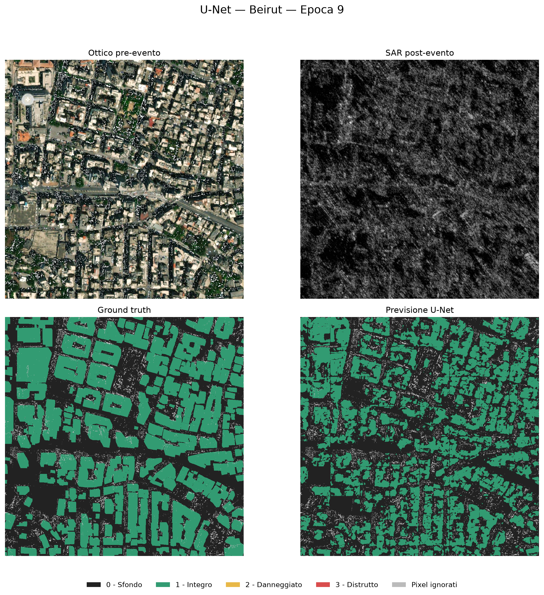
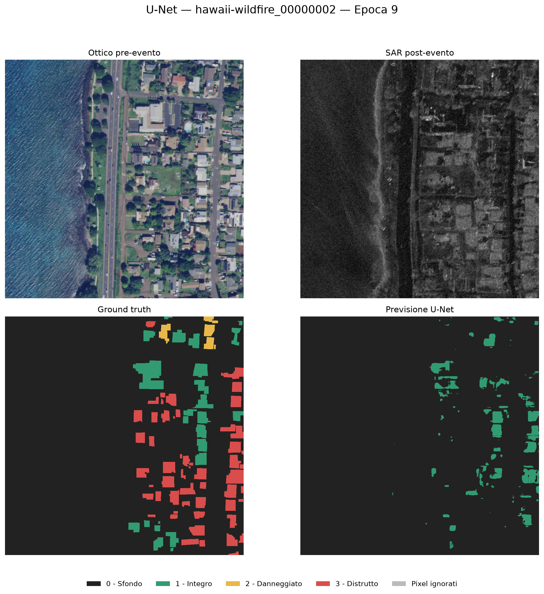
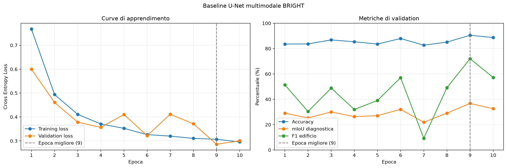

# BRIGHT · Riproduzione del DFC 2025, Track 2

È possibile riconoscere il danno a un edificio confrontando un’immagine ottica acquisita **prima** del disastro con un’immagine radar (SAR) acquisita **dopo**? Questo progetto di tesi triennale in Informatica studia il problema sul dataset BRIGHT. L’uscita attesa è una mappa in cui ogni pixel appartiene a una delle quattro classi: sfondo, edificio integro, danneggiato o distrutto.

L’obiettivo sperimentale è riprodurre la soluzione vincitrice del **2025 IEEE GRSS Data Fusion Contest, Track 2**, verificarne le prestazioni secondo un protocollo comparabile e utilizzare la riproduzione come riferimento per eventuali miglioramenti.

**Stato attuale (27 novembre 2026):** completate l’analisi dei dati, la preparazione sperimentale e una baseline U-Net multimodale su un campione di 18 immagini di training e 9 di validation. La pipeline è stata rieseguita da zero e i risultati principali sono stati riprodotti anche dopo la separazione dei notebook di preparazione e addestramento. La soluzione vincitrice non è ancora stata riprodotta.

## Percorso di lettura

| Notebook | Domanda a cui risponde | Stato |
|---|---|---|
| [01 · Esplorazione BRIGHT](01_esplorazione_bright.ipynb) | Come sono organizzati gli ingressi ottico/SAR e le annotazioni? | Completato |
| [02 · Dati e split](02_dati_e_split.ipynb) | Quali esempi compaiono nelle liste ufficiali e quali sono disponibili localmente? | Completato |
| [03 · Metriche](03_metriche.ipynb) | Come valutare la localizzazione degli edifici e le mappe del danno? | Completato |
| [04 · Preparazione sperimentale](04_preparazione_sperimentale.ipynb) | Come costruire un campione multimodale controllato e riproducibile? | Completato |
| [05 · Baseline U-Net](05_baseline_unet.ipynb) | Quali prestazioni raggiunge un primo modello di riferimento? | Completato |
| 06 · Building Extraction | Come riprodurre la localizzazione degli edifici dei vincitori? | Previsto |
| 07 · Change Detection | Come riprodurre la classificazione del danno dei vincitori? | Previsto |
| 08 · Confronto finale | Quali risultati, differenze e limiti emergono dal confronto? | Previsto |

## Organizzazione del codice

I notebook si trovano nella radice del progetto e descrivono gli esperimenti: configurazioni, chiamate alle funzioni, controlli, figure, tabelle e interpretazione dei risultati. Le implementazioni riutilizzabili sono raccolte in un unico package, [`src/bright_reproduction/`](src/bright_reproduction/), suddiviso in moduli con responsabilità distinte.

| Modulo | Responsabilità |
|---|---|
| `__init__.py` | Inizializzazione del package. |
| `download.py` | Ricerca e recupero dei GeoTIFF dagli archivi remoti, verifica dell’integrità. |
| `raster.py` | Lettura raster, maschere e validità congiunta delle modalità. |
| `geospatial.py` | Verifica delle griglie e delle sovrapposizioni geografiche. |
| `splits.py` | Lettura delle liste, split operativi e campionamento per evento. |
| `campione.py` | Controlli e statistiche sui dati del campione. |
| `data.py` | Dataset PyTorch, preprocessing multimodale ed estrazione delle patch. |
| `models.py` | Inizializzazione della U-Net originale BRIGHT senza duplicarne il codice. |
| `training.py` | Training, validation, gestione dello storico e checkpoint. |
| `metriche.py` | Matrici di confusione, metriche diagnostiche e confronto con il valutatore BRIGHT. |
| `inference.py` | Inferenza per patch e ricostruzione delle mappe complete. |
| `visualization.py` | Visualizzazione dei dati, delle previsioni e delle curve di apprendimento. |

## Preparazione sperimentale

### Split e campionamento

Le liste originali contengono 2.229 voci train, 661 holdout, 349 validation e 156 test: 3.395 voci per 3.393 identificativi distinti. `bata-explosion_00000049` compare in train e holdout; `libya-flood_00000024` compare in train e validation.

Per la baseline si uniscono train e holdout, si eliminano i duplicati e si escludono dal training gli identificativi della validation. Le liste originali rimangono inalterate.

| Split | Voci originali | ID operativi | Immagini utilizzate nella baseline |
|---|---:|---:|---:|
| Train + holdout | 2.890 | 2.888 | 18 |
| Validation | 349 | 349 | 9 |
| Test | 156 | 156 | 0 |

Il campione è selezionato con seed 42, scegliendo due immagini di training e una di validation per ciascuno dei nove eventi comuni. Gli identificativi sono disgiunti tra gli split operativi. I controlli delle estensioni geografiche non hanno rilevato sovrapposizioni rettangolari di area positiva tra le 18 immagini di training e le 9 di validation; questo non dimostra l’indipendenza geografica generale degli split.

Il notebook 04 recupera e verifica 81 GeoTIFF (ottico, SAR e maschera per ciascuna delle 27 immagini) e conserva le liste e la configurazione in [`risultati/04_baseline_unet/splits/`](risultati/04_baseline_unet/splits/). Il notebook 05 ricostruisce i Dataset leggendo `campione_train.txt`, `campione_val.txt` e `configurazione_dati.json`, senza dipendere dalle variabili in memoria del notebook 04.

### Preprocessing multimodale

- Concatenazione di RGB ottico pre-evento e SAR post-evento replicato su tre canali, per un ingresso a sei canali.
- Normalizzazione ImageNet, coerente con quella del caricatore dei vincitori esaminato.
- Validità congiunta delle modalità e della maschera, con criterio rigoroso per le tre bande ottiche. I pixel non validi delle modalità sono riempiti con zero nello spazio normalizzato; i target non validi sono marcati con `ignore_index=255`.
- Tolleranza di 0,05 pixel nel controllo delle griglie, introdotta per gestire le piccole discrepanze osservate nelle griglie SAR delle Hawaii, senza ricampionamento.
- Patch fisse non sovrapposte di 128 × 128 pixel. Nel training si escludono le patch interamente non valide; nella validation si mantiene la copertura completa.

| Quantità | Training | Validation |
|---|---:|---:|
| Immagini | 18 | 9 |
| Patch | 1.017 | 576 |
| Pixel validi | 15.680.907 | 8.062.840 |

Le classi sono fortemente sbilanciate: nel training circa l’86,48% dei pixel validi appartiene allo sfondo, il 10,85% agli edifici integri, il 2,15% ai danneggiati e lo 0,51% ai distrutti. Il criterio rigoroso di validità è una scelta conservativa della baseline e può escludere anche valori zero legittimi.

## Baseline U-Net

### Test preliminare su una singola patch

Il primo esperimento verifica forward, backward, aggiornamento dei pesi, inferenza e salvataggio del modello. Utilizza la patch centrale di 128 × 128 pixel di `bata-explosion_00000049`, con batch size 1, seed 42, AdamW, learning rate 0,0001 e Cross Entropy (`ignore_index=255`). Dopo un primo aggiornamento e 30 iterazioni aggiuntive, la loss delle iterazioni aggiuntive scende da 1,42167 a 0,59883.

Il test ha una finalità esclusivamente tecnica: le metriche sono calcolate sulla patch usata per l’addestramento e non misurano la generalizzazione. Utilizza inoltre il preprocessing esplorativo precedente alla gestione congiunta dei NoData.

### Configurazione dell’esperimento su più immagini

| Parametro | Valore |
|---|---|
| Architettura | U-Net originale BRIGHT, senza pesi preaddestrati |
| Parametri | 31.045.444 |
| Canali in ingresso / classi in uscita | 6 / 4 |
| Dimensione patch | 128 × 128 |
| Batch size | 4 |
| Ottimizzatore | AdamW |
| Learning rate | 0,0001 |
| Loss | CrossEntropyLoss, senza pesi per classe, `ignore_index=255` |
| Epoche | 10 |
| Seed | 42 |
| Campionamento | Uniforme con shuffle nel training |
| Data augmentation | Non utilizzata |
| Dispositivo verificato | MPS (GPU Apple) |
| Selezione checkpoint | Massima mIoU diagnostica di validation |

La maschera del danno è utilizzata come target, non come ingresso. La rete restituisce quattro logits per pixel e la previsione si ottiene con `argmax`. Le metriche vengono calcolate sulla matrice di confusione aggregata dei pixel validi, non come media delle metriche dei singoli batch.

### Risultati sul campione di validation

Il checkpoint migliore è quello dell’**epoca 9**. Il controllo «sempre sfondo» è valutato sugli stessi pixel validi.

| Metrica | Sempre sfondo | U-Net · epoca 1 | U-Net · epoca 9 |
|---|---:|---:|---:|
| Accuracy | 82,58% | 83,55% | **90,47%** |
| mIoU diagnostica | 20,64% | 29,05% | **36,73%** |
| F1 edificio (binario) | 0,00% | 51,37% | **71,99%** |

| Classe | Pixel reali | Pixel predetti (epoca 9) | IoU (epoca 9) |
|---|---:|---:|---:|
| Sfondo | 6.658.038 | 6.821.728 | 89,58% |
| Integro | 1.298.195 | 1.241.092 | 57,31% |
| Danneggiato | 33.607 | 20 | 0,01% |
| Distrutto | 73.000 | 0 | 0,00% |

La baseline apprende parzialmente la localizzazione degli edifici, ma non distingue in modo efficace le classi di danno. L’elevata accuracy risente della predominanza dello sfondo. Lo sbilanciamento delle classi è una possibile spiegazione, da verificare sperimentalmente.

La mIoU diagnostica esclude le classi con IoU indefinita (assenti sia nel riferimento sia nella previsione); la mIoU a quattro classi assegna loro zero; la mIoU delle classi presenti considera soltanto le classi del riferimento. Sul campione completo di validation tutte e quattro le classi sono presenti e le tre convenzioni coincidono. F1 edificio misura la localizzazione binaria edificio/sfondo, non la classificazione del danno.

**Questi risultati sono diagnostici:** la validation è separata dal training per identificativo, ma è anche utilizzata per selezionare il checkpoint. Non è stato eseguito un test finale indipendente e non si tratta di punteggi ufficiali DFC 2025. Prima di confrontarsi con la classifica occorre verificare il protocollo di valutazione ufficiale.

### Risultati qualitativi

**Beirut — localizzazione degli edifici.** La ground truth contiene sfondo ed edifici integri; la figura permette di osservare la capacità di localizzazione e la qualità dei contorni.



**Hawaii — riconoscimento del danno.** Esempio selezionato sulla base della maggiore quantità di pixel danneggiati e distrutti nelle annotazioni valide, non in base alle prestazioni del modello. Nessuno dei 78.211 pixel realmente danneggiati o distrutti viene classificato correttamente.



**Curve di apprendimento.** Andamento delle loss e delle metriche durante le dieci epoche, con evidenziazione dell’epoca migliore.



L’inferenza ricostruisce mappe da 1024 × 1024 pixel a partire dalle patch. Le mappe diagnostiche escludono i pixel non validi anche in base alla maschera di riferimento: non costituiscono ancora una pipeline di inferenza indipendente dalle annotazioni. L’uso di patch non sovrapposte può produrre artefatti ai bordi.

Le tabelle CSV, le matrici di confusione e le figure sono disponibili in [`risultati/04_baseline_unet/`](risultati/04_baseline_unet/). Il nome storico della cartella è stato mantenuto anche dopo la separazione dei notebook 04 e 05.

### Riproducibilità

La versione consolidata del notebook originario è stata rieseguita da zero nello stesso ambiente Mac/MPS: il confronto dei CSV ha restituito differenza numerica massima 0 per le loss e le metriche delle dieci epoche (esclusi i tempi) e matrici di confusione identiche per tutte le epoche.

Dopo la separazione nei notebook 04 e 05, entrambi sono stati rieseguiti. I conteggi dei dati, le metriche riportate nello storico alla precisione visualizzata, l’epoca migliore e la relativa matrice di confusione coincidono con l’esperimento precedente. Il checkpoint migliore ricaricato riproduce la matrice di validation salvata. Il confronto integrale dei CSV con il backup originale non è stato ripetuto dopo la separazione, perché il file di riferimento non era più disponibile al percorso previsto.

Non è stata verificata l’identità binaria dei pesi tra addestramenti né la riproducibilità numerica su hardware o versioni software differenti.

## Come riprodurre il progetto

L’ambiente di riferimento è Python 3.11.9 su macOS arm64, con VS Code e Jupyter, PyTorch 2.14.1 e Rasterio 1.4.4. Il training è stato verificato con MPS; CUDA non è disponibile sul Mac utilizzato. [`requirements.txt`](requirements.txt) riporta le versioni dell’ambiente di analisi. L’installazione da zero su altre configurazioni resta da verificare.

**1. Preparare l’ambiente.** Dalla radice del repository:

```bash
python3.11 -m venv .venv
source .venv/bin/activate
python -m pip install -r requirements.txt
python -m pip install -e . --no-deps
python -m ipykernel install --user --name bright-dfc2025 --display-name "Python (BRIGHT DFC2025)"
```

Se si dispone già dell’ambiente `venv-tesi` con il package installato, è sufficiente selezionare il relativo kernel. L’installazione editable permette ai notebook di importare il codice direttamente da `src/`.

**2. Recuperare il riferimento BRIGHT.** I notebook leggono le liste, il codice delle metriche e la U-Net dalla copia locale:

```bash
git clone https://github.com/ChenHongruixuan/BRIGHT.git BRIGHT
git -C BRIGHT checkout 59269142f3a3550320513e362692732f46486985
```

**3. Eseguire i notebook nell’ordine 01 → 02 → 03 → 04 → 05**, mantenendo la radice del progetto come directory di lavoro e selezionando il kernel preparato. Il notebook 01 recupera gli esempi iniziali dall’[archivio BRIGHT](https://huggingface.co/datasets/Kullervo/BRIGHT) in `dati/bright_esempi/`; il 04 recupera il campione operativo in `dati/bright_baseline/`. Le procedure di ricerca e verifica degli archivi richiedono accesso a Internet anche se sono già presenti dati locali. Il 05 usa i dati e i file di configurazione prodotti dal 04.

I checkpoint locali prodotti dal notebook 05 sono:

```text
checkpoints/
├── unet_overfit_patch.pt
├── unet_baseline_epoca_01.pt
├── unet_baseline_migliore.pt
└── unet_baseline_ultimo.pt
```

Contengono lo stato del modello e dell’ottimizzatore, la configurazione e lo storico dell’esperimento. La ripresa dell’addestramento dall’ottimizzatore non è ancora verificata. I checkpoint e i dati non sono distribuiti con il repository. **Rieseguire i notebook sovrascrive i risultati e i checkpoint con gli stessi nomi:** conservare una copia degli esperimenti che si desidera confrontare.

**4. Recuperare il codice dei vincitori (per le prossime fasi).** Non è necessario per eseguire i primi cinque notebook:

```bash
git clone https://github.com/Henryjiepanli/Building-Guided-Pseudo-Label-Learning-for-Cross-Modal-Building-Damage-Mapping.git soluzione_vincitori
git -C soluzione_vincitori checkout fe8a8580949dc4e1e38a5a1e3901cee7e20f806b
```

Le copie dei repository esterni e i dati non sono inclusi; per il loro utilizzo valgono le condizioni delle rispettive fonti.

## Prossime fasi

| Fase | Obiettivo | Stato |
|---|---|---|
| 1 · Preparazione e baseline | Costruire e verificare una pipeline sperimentale riproducibile. | Completata sul campione operativo |
| 2 · Building Extraction | Verificare l’ambiente di esecuzione e riprodurre la localizzazione degli edifici del metodo vincitore. | Da iniziare |
| 3 · Change Detection | Integrare le mappe degli edifici, ricostruire il metodo con pseudo-etichette e post-processing. | Da iniziare |
| 4 · Confronto finale | Verificare il protocollo ufficiale, confrontare i metodi a condizioni comparabili e discutere gli errori. | Da iniziare |

Nei materiali dei vincitori esaminati non sono stati individuati i pesi finali; gli script contengono chiamate esplicite a CUDA. Prima della fase 2 occorre verificare dipendenze, disponibilità GPU e fattibilità dell’addestramento, valutando MPS oppure un ambiente NVIDIA remoto. La scala degli esperimenti e l’eventuale confronto con il benchmark completo dipenderanno dalle risorse disponibili e dalle indicazioni del relatore.

Eventuali miglioramenti (loss pesata, campionamento bilanciato o altri interventi mirati) saranno considerati soltanto dopo aver affrontato la riproduzione del metodo vincitore, compatibilmente con le risorse e i tempi della tesi.

## Riferimenti

- [BRIGHT — repository originale](https://github.com/ChenHongruixuan/BRIGHT)
- [BRIGHT — archivio del dataset](https://huggingface.co/datasets/Kullervo/BRIGHT)
- [Building-Guided Pseudo-Label Learning for Cross-Modal Building Damage Mapping — codice dei vincitori](https://github.com/Henryjiepanli/Building-Guided-Pseudo-Label-Learning-for-Cross-Modal-Building-Damage-Mapping)
